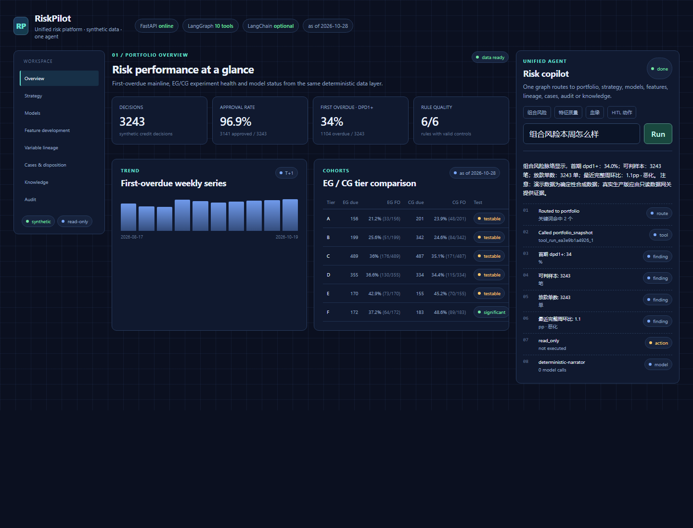
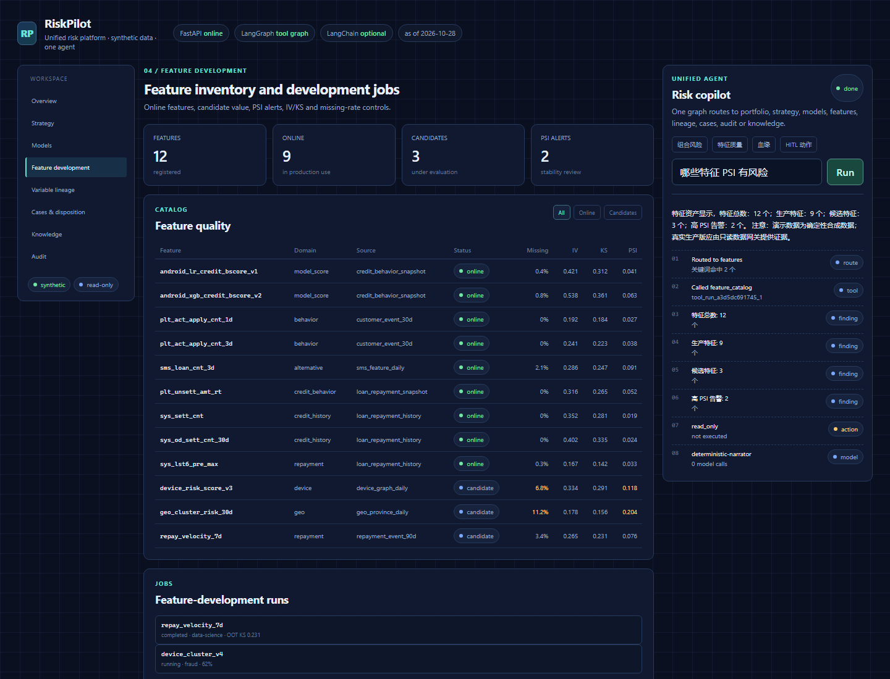
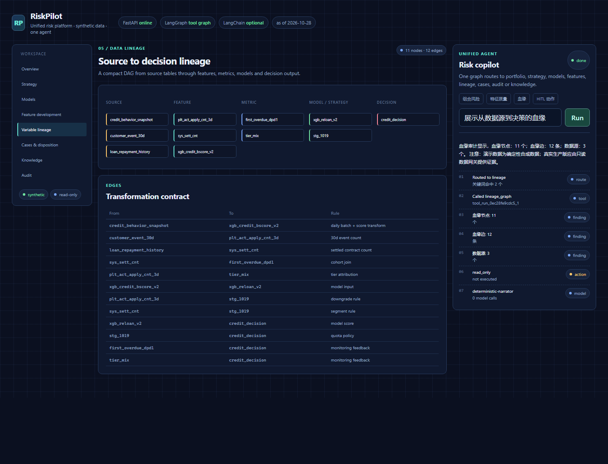

# RiskPilot · Agentic Risk Strategy Cockpit

面向小周期现金贷风险策略团队的可交互作品集项目：把风险 KPI、实验分层、规则质量、模型体检和可恢复 Agent 工作流放在同一个真实可运行的应用里。

> 全部数据由固定种子生成，不含任何真实客户、手机号、卡号或公司生产数据。



知识 Agent 不是一个独立页面，而是同一工作台中的一个模块：

- `/company-agent` 兼容旧链接，会跳转到统一工作台的 `#knowledge`
- 只读 markdown 知识库检索
- 回答附带文件、章节、行号和原文片段
- 无证据时拒答
- 对外发送客户数据等敏感操作必须人工审批

## 技术栈

- **FastAPI**：API、静态页面和健康检查
- **LangGraph**：意图路由、工具节点、证据聚合、人工审批、SQLite checkpoint
- **LangChain**：模型适配与可选的自然语言措辞
- **Python 3.11**：确定性合成数据、统计检验和业务计算
- **原生 HTML/CSS/JS**：零前端构建步骤，单进程启动

## 能演示什么

### 1. 风险策略驾驶舱

- 首期 `dpd1+` 首逾主线，T+1 可判
- EG / CG 分档对比，同时返回率、分子和分母
- 两比例 z 检验和最小样本门槛
- 完整到期周才参与周环比，未成熟周显示“观察中”
- 规则命中组与同基础档对照组的风险差
- 模型 AUC、样本量和“口径未定 / 样本不足 / 衰减 / 接近随机”判定

### 2. LangGraph Agent

```text
START
  ↓
route
  ├─ clarify ───────────────────────────── END
  ↓
evidence (LangChain tool contract)
  ├─ read question ──→ finish
  ↓ write intent
approval (interrupt)
  ↓ resume
execute_action ──→ narrator ──→ END
```

Agent 不直接计算业务指标，只调用确定性工具。回答附带：

- 路由原因
- 工具名和 `call_id`
- 结构化 findings
- 不确定性
- 最终动作状态

写操作必须先经过 LangGraph `interrupt()`；未批准时不会生成执行记录。

### 3. Unified workspace modules

同一个 Agent 工作台包含：

- Overview：组合风险、首逾、EG/CG
- Strategy：策略版本、规则和规则质量
- Models：模型注册表与 AUC 体检
- Feature development：特征目录、IV/KS/PSI、候选特征和开发任务
- Variable lineage：数据源 → 特征 → 指标 → 模型/策略 → 决策
- Cases & disposition：案件、SLA 和人工处置
- Knowledge：政策检索、引用和敏感动作边界
- Audit：操作轨迹与审批状态

知识模块是公司内部 Agent 的公开安全版本：

它保留“先检索知识、引用来源、敏感操作需确认”的设计，但不包含真实公司资料。

- 只允许读取 `demo_knowledge/` 下的 markdown
- 拒绝路径越界
- 按章节检索并附引用
- “没有证据”返回显式拒答
- 客户数据外发等请求标记 `approval_required`

特征开发与血缘不是空入口：





## 快速开始

```powershell
cd .\ai-risk-platform-demo
python -m venv .venv
.\.venv\Scripts\python.exe -m pip install -e ".[dev]"
.\.venv\Scripts\python.exe run.py
```

打开 <http://127.0.0.1:8000>。

也可以使用启动脚本：

```powershell
.\start.ps1
```

## 可选 LLM

未配置模型时，系统使用确定性 narrator，所有 KPI、Agent 路由和 HITL 仍可运行。

如需启用 LangChain 模型措辞：

```powershell
Copy-Item .env.example .env
```

```dotenv
DEMO_LLM_API_KEY=your-key
DEMO_LLM_BASE_URL=https://api.deepseek.com/v1
DEMO_LLM_MODEL=deepseek-chat
```

模型只被允许引用工具输出中的数字，不能自行生成指标。

## API

| Method | Path | Purpose |
|---|---|---|
| GET | `/health` | 服务与框架健康检查 |
| GET | `/api/kpi` | 驾驶舱全部 KPI |
| GET | `/api/workspace` | 统一工作台的全部模块数据 |
| GET | `/api/platform/features` | 特征目录、质量与开发任务 |
| GET | `/api/platform/lineage` | 数据源到决策的血缘 |
| GET | `/api/platform/cases` | 案件与处置状态 |
| GET | `/api/platform/audit` | 审计轨迹 |
| GET | `/api/meta` | Agent、工具和运行时元数据 |
| POST | `/api/agent/runs` | 发起一次 LangGraph Agent run |
| GET | `/api/agent/runs/{thread_id}` | 读取 checkpoint 状态 |
| POST | `/api/agent/runs/{thread_id}/resume` | 批准或拒绝暂停动作 |
| GET | `/api/demo/contracts` | Demo 数据契约 |

示例：

```bash
curl -X POST http://127.0.0.1:8000/api/agent/runs \
  -H "Content-Type: application/json" \
  -d '{"question":"规则质量里哪些规则在陪跑"}'
```

## 测试

```powershell
.\.venv\Scripts\python.exe -m pytest tests -q
```

覆盖：

- KPI 分子分母和统计量
- 规则质量精准 / 陪跑判定
- LangGraph 统一路由到特征、血缘、审计、知识库与组合风险工具
- 写动作暂停、人工批准与恢复
- FastAPI 页面、API、知识检索和路径越界保护

## 目录

```text
app/
  main.py           FastAPI routes + static hosting
  graph.py          LangGraph workflow and HITL
  agent_state.py    typed graph state and reducers
  agent_tools.py    tool contracts and deterministic reads
  platform_data.py  feature, lineage, case, audit and strategy snapshots
  kpi.py            KPI, tier, power and rule quality
  demo_data.py      seeded synthetic data
  knowledge.py      safe markdown retrieval and citations
  knowledge_agent.py grounded policy graph
  narrator.py       optional LangChain model adapter
public/
  index.html        cockpit shell
  styles.css        responsive visual system
  app.js            API rendering and approval controls
  workspace.css     unified workspace layout
demo_knowledge/     fictional approved markdown knowledge base
tests/
  test_agent.py
docs/
  architecture.md
  company-agent-case-study.md
  metrics.md
  fail-loudly.md
  resume-bullets.md
  interview-narrative.md
```

## 设计边界

- Demo 数据是内存合成数据，不接生产库。
- Agent 工具是代码白名单，不接受自由 SQL。
- LLM 不是核心计算引擎，可完全关闭。
- 所有率值都返回分子和分母；样本不足不强行判定。
- 示例处置动作只写入内存 action ledger，不代表真实业务写操作。

## License

MIT
